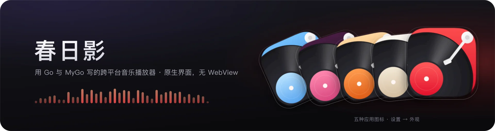
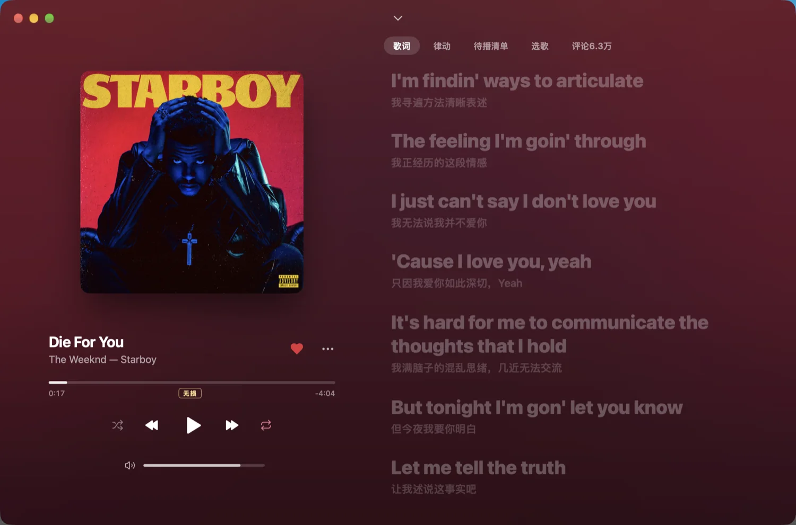
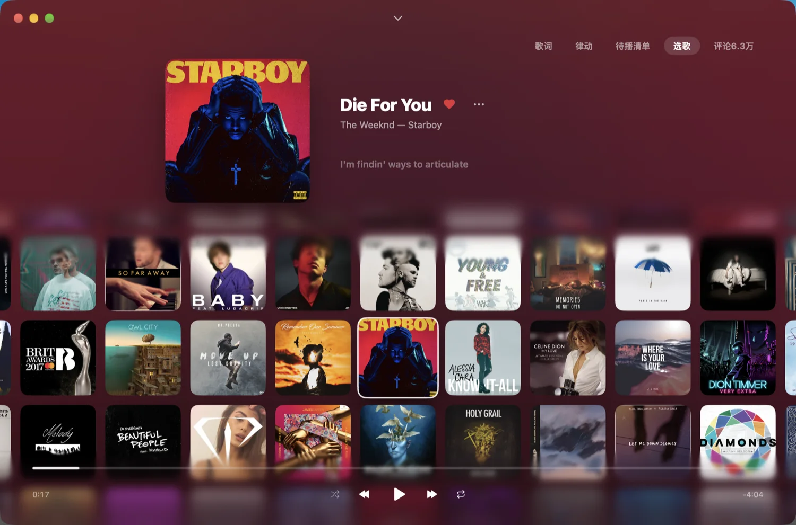
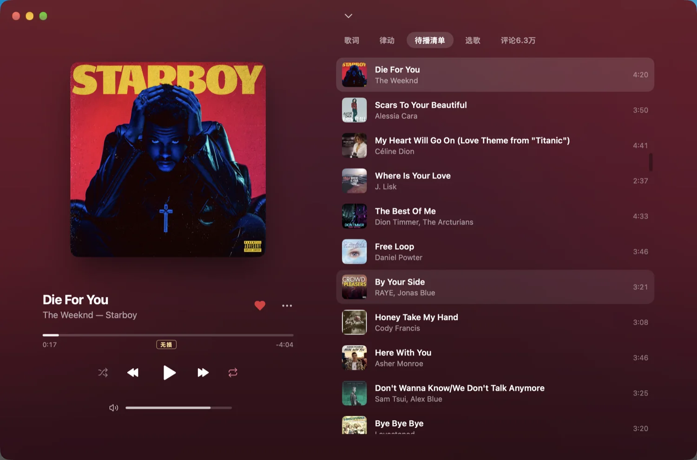

# 春日影

<p align="center">

</p>

<p align="center">
用 Go 和 <a href="https://github.com/egoist/mygo">MyGo</a> 写的跨平台音乐播放器，原生界面，无 WebView。
</p>

<p align="center">
<a href="https://yxxbc.github.io/haruhikage-support/">官网</a> ·
<a href="https://github.com/yxxbc/haruhikage-support/releases/latest">下载</a> ·
<a href="https://github.com/yxxbc/haruhikage-support/releases">全部版本</a> ·
<a href="https://github.com/yxxbc/haruhikage-support/issues">问题反馈</a>
</p>

<p align="center">
<a href="https://github.com/yxxbc/haruhikage-support/releases/latest"></a>
<a href="LICENSE"></a>
</p>

> 这个仓库只放安装包、更新清单和运行时文件。源码不公开，构建由 Release workflow 从私有源码仓库完成。

## 下载

到 [Releases](https://github.com/yxxbc/haruhikage-support/releases/latest) 下载最新版：

| 平台 | 安装包 |
| --- | --- |
| macOS（Apple 芯片） | `haruhikage-app-<version>-arm64.dmg` |
| macOS（Intel） | `haruhikage-app-<version>-amd64.dmg` |
| Windows | `haruhikage-app-setup-<version>-amd64.exe` · `arm64.exe` |
| Linux（Debian / Ubuntu） | `haruhikage-app_<version>_amd64.deb` · `arm64.deb` |
| Linux（其他发行版） | `haruhikage-app-<version>-linux-amd64.tar.gz` · `arm64.tar.gz` |

macOS 包是 ad hoc 签名、未公证，第一次打开如果被拦截，请右键「打开」，或者执行：

```sh
xattr -dr com.apple.quarantine /Applications/春日影.app
```

命令行安装：

```sh
curl -fsSL https://github.com/yxxbc/haruhikage-support/releases/latest/download/install.sh | sh
```

## 界面



<p align="center"><sub>正在播放 · 逐字歌词与翻译</sub></p>

| 待播清单 | 选歌 |
| :---: | :---: |
|  |  |
| <sub>队列里的歌，随时切换</sub> | <sub>在封面墙里挑下一首</sub> |

## 功能

- 原生界面，macOS / Windows / Linux，无 WebView
- 播放队列、随机与循环、音量均衡、暂停与继续的淡入淡出
- 逐字歌词与翻译，正在播放页的「律动」视图
- 本地音乐：在设置里选择文件夹，扫描缺失的标题、歌手、专辑、封面和歌词，预览后写回 FLAC
- 听过的歌曲缓存在本机，再次播放无需等待
- 退出后再打开，从上次的播放队列与进度继续
- 跨设备同步：通过 iCloud Drive 接续播放进度和设置
- 设置里的「存储」显示本机容量、应用占用和歌曲缓存上限
- 刘海播放器：在屏幕顶部刘海处显示迷你播放器，悬停展开（macOS）
- 浅色 / 深色 / 跟随系统

## 更新

应用检查本仓库的最新 release。每个版本包含六个平台的安装包和签名更新清单：

```sh
# 看当前最新版
curl -sL https://github.com/yxxbc/haruhikage-support/releases/latest/download/update-darwin-arm64.json | jq -r .version
```

更新包用 Ed25519 签名，应用只接受与内置公钥匹配的更新。

## 发布新版本

维护者流程：

1. 在源码仓库改 `mygo.json` 的 `version`，在 `CHANGELOG.md` 顶部写对应版本段
2. 推 `main`，打 tag `v<version>`，推 tag
3. 在本仓库 Actions 里运行 **Release**，`ref` 填 `v<version>`：

   ```sh
   gh workflow run release.yml --repo yxxbc/haruhikage-support -f ref=v0.1.28
   ```

4. 等 macOS / Windows / Linux 三个 job 都完成，检查 draft 里的安装包和 `update-*.json`
5. 发布并标记 latest：

   ```sh
   gh release edit v0.1.28 --repo yxxbc/haruhikage-support --draft=false --latest
   ```

6. 验证 latest 清单和更新包：

   ```sh
   curl -sL https://github.com/yxxbc/haruhikage-support/releases/latest/download/update-darwin-arm64.json | jq -r '.version, .url'
   ```

旧仓库 `yxxbc/haruhikage-app` 已经完成迁移，只剩一个 `v0.1.28` 的 bridge release；后续版本不需要再动它。

## 运行时文件

语音转写等按需下载的文件放在独立的 prerelease 里，用固定 tag 标记，不会成为最新 release：

- `sherpa-onnx-<version>`：本机语音识别库

## 许可证

[AGPL-3.0](LICENSE)
